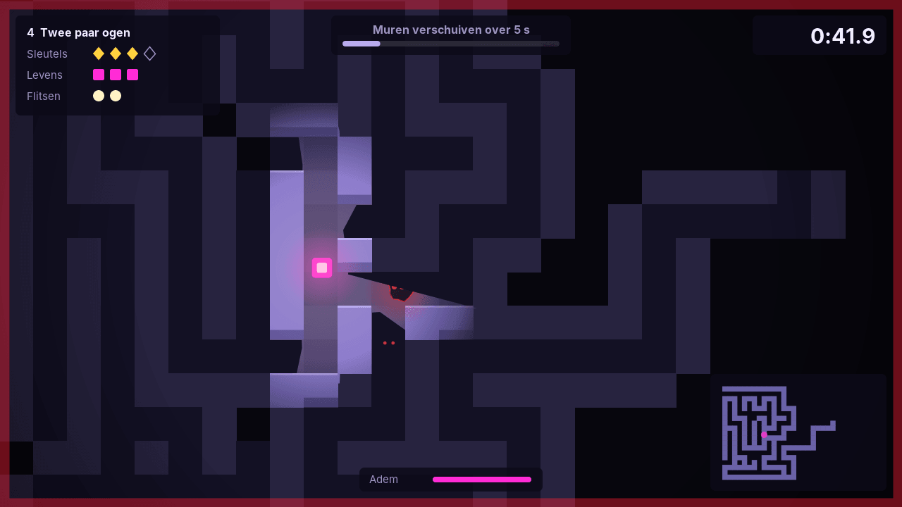
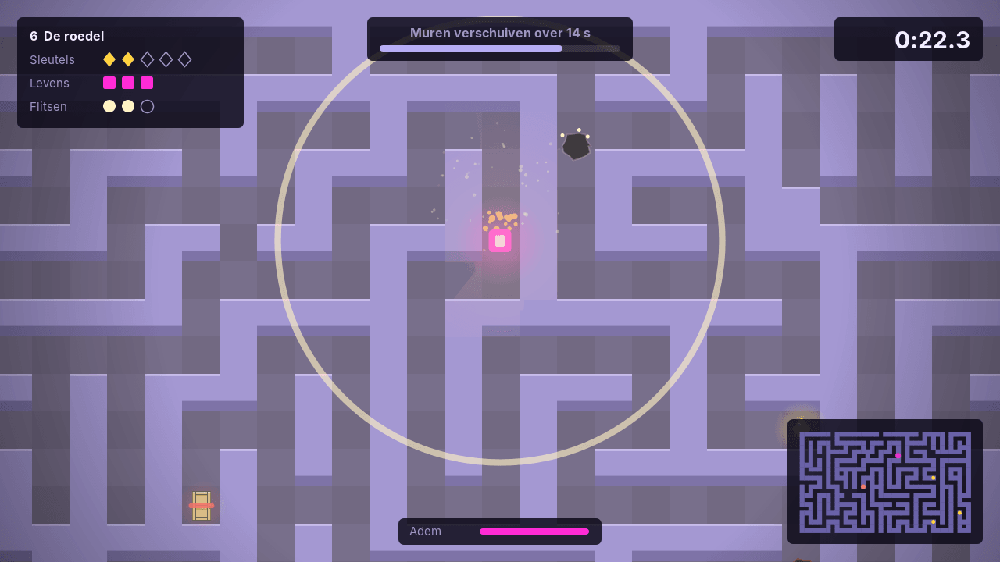
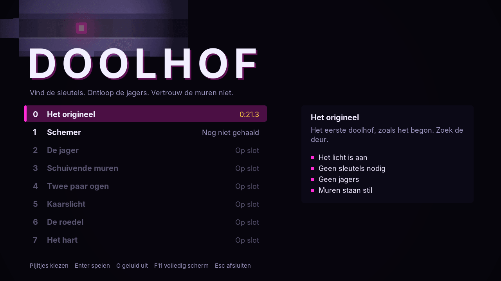
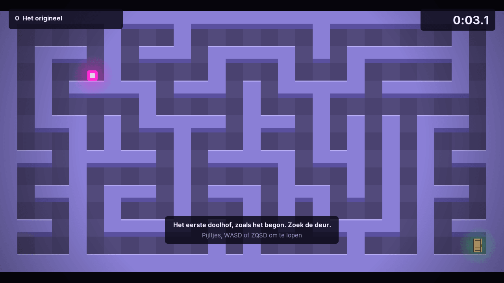

# Doolhof

A maze game played in the dark. You see only what your light reaches, the keys
are far apart, hunters roam the corridors, and every so often the walls move.

Written in plain Java 21 with Swing and Java 2D. No game engine and no
libraries: the maze generator, the path finding, the line-of-sight lighting,
the enemy behaviour and even the sound effects are in this repository.



| | |
| --- | --- |
|  |  |

The game is in Dutch; the code and documentation are in English.

## How it started

The first version was one of my first programs: a single class with the walls
typed in as 53 rectangles, a magenta square that jumped from tile to tile, and
a door. That maze is still in the game as level 0, *Het origineel*, built from
the same rectangles, and the player is still the magenta square.



## Playing

| Key | Action |
| --- | --- |
| Arrow keys, WASD or ZQSD | Walk |
| Shift | Sprint: faster, but it empties your breath and hunters hear it |
| Space | Light flare: shows the whole level for a few seconds and stuns nearby hunters |
| M or Tab | Show or hide the map of what you have seen |
| Esc or P | Pause |
| G | Sound on or off |
| F11 | Full screen |

Find every key, then reach the door. A hunter that touches you costs one of
your three lives and sends you back to the start.

| Level | New in this level |
| --- | --- |
| 0 Het origineel | The first maze, fully lit |
| 1 Schemer | Darkness and keys |
| 2 De jager | A hunter |
| 3 Schuivende muren | Walls that move every 26 seconds |
| 4 Twee paar ogen | Two hunters |
| 5 Kaarslicht | A much smaller light |
| 6 De roedel | Three hunters |
| 7 Het hart | Four hunters, six keys, walls that move every 15 seconds |

Best times and unlocked levels are saved in `~/.doolhof/progress.properties`.

## Running

Requirements: a JDK, version 21 or newer, and [Maven](https://maven.apache.org/).

```bash
mvn package                        # compiles, runs the tests, builds the jar
java -jar target/doolhof-2.0.0.jar
```

In IntelliJ IDEA: open the folder (it reads `pom.xml`) and run
`com.sarah.doolhof.Main`.

## Architecture

The code is split into three layers. Each layer only knows the one below it.

```text
 presentation      Swing window, keyboard, drawing, sound
      │   sends PlayerInputDTO, receives GameDTO and LevelDTO
      ▼
 domain            services  ─►  model and maze (the rules)
      │   loads and saves Progress
      ▼
 persistence       ProgressRepository  ─►  a file in the home folder
```

```text
src/main/java/com/sarah/doolhof
├── Main                    builds the three layers and connects them
├── presentation/           LAYER 1
│   ├── GameWindow, GamePanel, KeyboardState
│   ├── render/             WorldRenderer, Hud, Screens, Camera, Particles, Palette
│   └── audio/              Sound
├── domain/                 LAYER 2
│   ├── service/            the way in for the presentation layer
│   │   ├── GameService     start a level, let time pass, get a snapshot
│   │   ├── LevelService    the level list, what is unlocked, best times
│   │   ├── GameMapper      model -> DTO, the only class that knows both
│   │   └── Autopilot       plays a level by itself (menu demo, tests)
│   ├── model/              World, Player, Hunter, Level, Progress, ...
│   └── maze/               Maze, MazeGenerator, Pathfinder, MazeShifter, Visibility
├── persistence/            LAYER 3
│   ├── ProgressRepository          interface
│   └── FileProgressRepository      ~/.doolhof/progress.properties
├── dto/
│   ├── request/            PlayerInputDTO
│   └── response/           GameDTO, LevelDTO, MazeDTO, PlayerDTO, HunterDTO, ...
├── common/                 enums every layer may use: GameStatus, HunterState, GameEvent, TileMemory
├── config/                 GameRules: every speed, distance and timer in one file
└── exception/              LevelLockedException, LevelNotFoundException, ...
```

The rules that keep this honest:

- **The screen never touches the model.** `GamePanel` calls `GameService` and
  `LevelService` and draws the DTOs they return. It cannot move the player or
  open a door, because it never holds a `Player` or a `World`.
- **DTOs are immutable snapshots.** They are records; the ones that carry
  arrays copy them on the way in and on the way out.
- **The domain never draws.** No class under `domain`, `dto` or `persistence`
  imports Swing, AWT or the sound API, so the whole game can be played in a
  test without a window.
- **The domain does not know where progress is stored.** `LevelService` gets a
  `ProgressRepository` through its constructor. The game gets the file version,
  the tests get a Mockito mock.
- **These rules are tested.** `LayerRulesTest` reads the imports of every source
  file and fails the build when a layer reaches for something it should not
  know.

## How it works

**Generating a maze.** A depth-first walk carves corridors from room to room,
which gives a maze with exactly one route between any two tiles. Then a share
of the dead ends is opened up, creating loops: without them a hunter in a
corridor could not be avoided. The same seed always gives the same maze, so a
level is identical on every attempt and best times can be compared.

**Moving walls.** A shift opens some walls and closes some corridors. Each
closing is tried on a copy first and undone if any tile becomes unreachable,
so a shift can make your route longer but can never trap you or cut off a key.
The plan is made a few seconds early, which is the warning you see; when it is
carried out, every closing is checked again against where everyone is now.

**Light and shadow.** 540 rays are cast from the player and stopped by the
first wall, using a grid traversal that jumps from tile border to tile border.
Their end points form the lit area. The scene is drawn off-screen and cut out
with that shape, so walls cast real shadows. Tiles you have seen stay on the
map as you remember them, which after a wall shift may no longer be true.

**Hunters.** Each hunter is a small state machine: patrol, chase on sight,
search where you were last seen, give up. They see along straight lines up to
a distance, and they hear sprinting. A chasing hunter is faster than you walk
and slower than you sprint.

**Fixed time step.** Real time is cut into steps of 1/120 second. A slow
computer takes more steps per frame, a fast one fewer, and the game behaves
the same on both.

**The game loop.** `GameService.advance` owns the fixed time step, so it is
a rule of the game and not of the window. `World` gets all its randomness from
one seeded generator: the same seed and the same input always give the same
game, which is what makes the rules testable by simulation.

## Tests

```bash
mvn test
```

156 tests with JUnit 5 and Mockito, organised like the code. Some of the more interesting ones:

- the generator: every tile reachable, and without loops exactly one route
  between any two tiles
- wall shifting: the maze stays fully connected through hundreds of shifts
- every level is played to the end by an autopilot, which proves that each one
  can be finished
- every level is played for three simulated minutes with hunters, checking
  after each step that nobody is inside a wall
- the services: a level is won through the public API by a test player that
  only sees DTOs, and the best time ends up in the repository
- the same input gives the same result at 30 and at 240 frames per second
- the layer rules described above

## Possible next steps

- A level editor, and levels loaded from files
- Hunters that work together to cut off escape routes
- A daily maze with a shared seed and an online leaderboard
